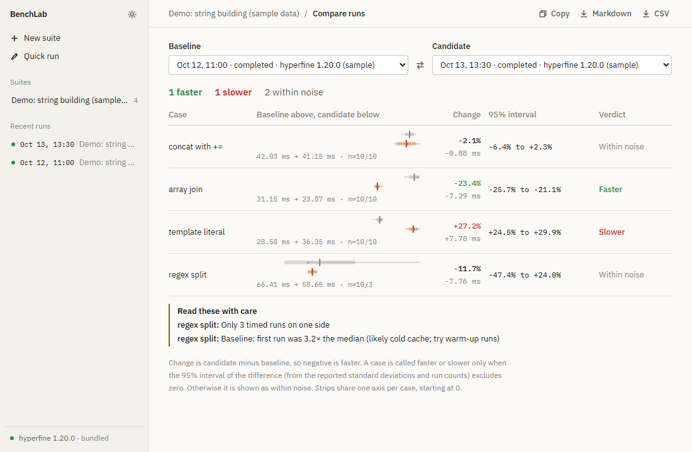
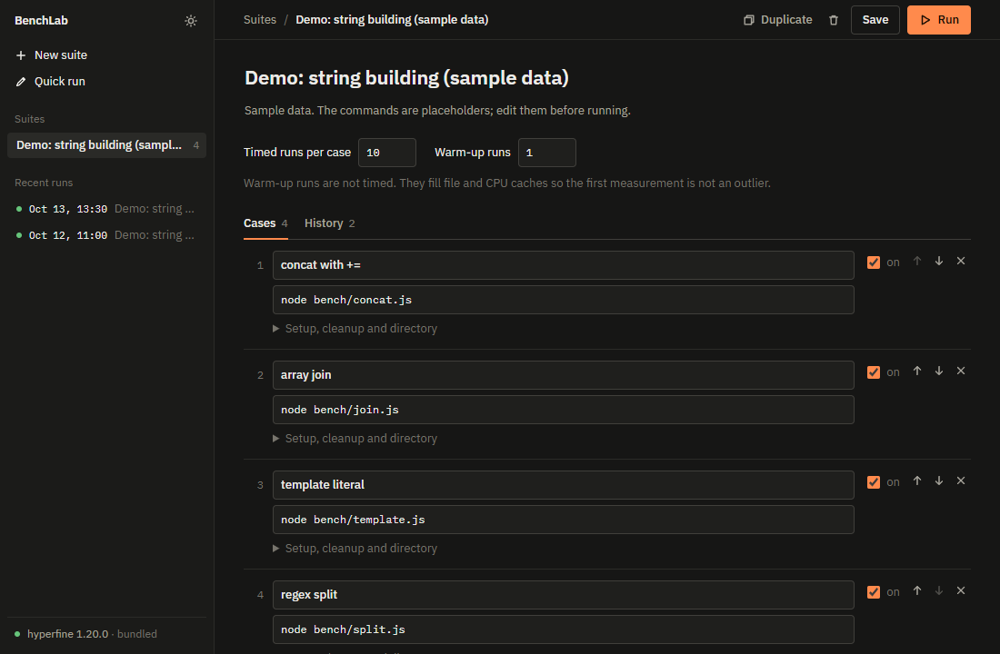
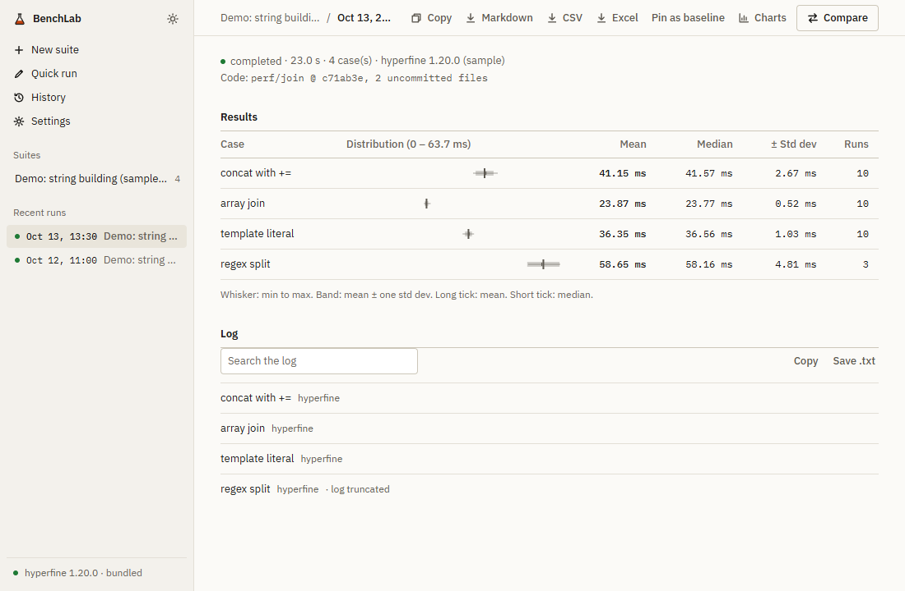

# BenchLab

A desktop app for the question hyperfine leaves to you: **did my change make it slower?**

[hyperfine](https://github.com/sharkdp/hyperfine) times commands well. BenchLab keeps the work around it: saved suites you can rerun identically, a history of every run with the configuration it used, a comparison that says when it is not sure, and Markdown or CSV you can paste into a pull request.



## What it adds over hyperfine

| | hyperfine alone | BenchLab |
|---|---|---|
| Rerun the same benchmark later | Retype or script the command line | Saved suite: cases, setup, cleanup, working directory, runs, warm-up |
| Remember past results | Whatever you saved by hand | Every run stored with its raw output, a snapshot of the suite configuration, and the git commit it measured |
| Compare two runs | Eyeball two terminal outputs | Per-case change with a 95% interval, a verdict, and caveats |
| Share results | Copy text | Markdown and CSV export, copy as Markdown |
| Install | Separate | Ships its own hyperfine |

BenchLab does not replace hyperfine. It runs it for you and records what happened.

## Good to know

BenchLab looks for hyperfine in this order:

1. The file named by the `BENCHLAB_HYPERFINE` environment variable (it must exist; a wrong path is an error, not a silent fallback).
2. The copy bundled with the app.
3. `hyperfine` on your `PATH`.

The sidebar footer shows which one is in use and its version. Every run records the version that produced it.

## Using it

1. **New suite.** Name it, add cases (a name and a command each), and choose timed runs and warm-up runs. Setup and cleanup commands and a working directory are under each case.
2. **Run.** BenchLab first shows every command, setup, cleanup and directory, and runs nothing until you confirm. You can cancel a running suite; cases already finished are kept.
3. **Compare.** Open a run and choose Compare. The baseline defaults to the suite's pinned run (pin one from a run's page with Pin as baseline), or to the previous run that has results if none is pinned. Pick any two runs of the suite.
4. **Export.** Markdown or CSV from a run or a comparison.

**Quick run** times a single command without saving anything. **Load sample data** (sidebar or Quick run) creates a demo suite with two finished runs, so you can look at every screen without running a thing.



Shortcuts: `Ctrl+S` save, `Ctrl+Enter` open the run dialog, `Esc` close it.

## How to read a comparison

Change is candidate minus baseline, so negative is faster.

- A case is called **faster** or **slower** only when the 95% interval of the difference excludes zero. The interval comes from the standard deviation and run count hyperfine reports for each side (a Welch-style test). Anything else is **within noise**.
- Strips show min to max, mean plus or minus one standard deviation, the mean and the median, on one shared axis starting at zero.
- Per-case notes flag: fewer than 5 timed runs, no standard deviation, non-zero exit codes, and a first run at least 1.5 times the median (a likely cold cache; use warm-up runs).
- If a case runs inside a git repository (its working directory is set), the run records the branch, commit and whether there were uncommitted changes when it started. A comparison says when both runs used the same commit (so any difference is noise or the environment) and warns when either ran with uncommitted changes, since the commit then does not fully describe the code.
- A case can have a **regression budget** (percent slower than the baseline, set under the case's advanced options). It is reported as over budget only when the whole 95% interval of the change is above the budget, as within budget only when the whole interval is at or below it, and otherwise as "data cannot tell". A noisy case with a large point estimate is therefore not called a breach, and a quiet case is not waved through on its mean alone.
- Above the table, BenchLab lists configuration differences between the two runs: timed runs, warm-up, a changed command, setup, cleanup or directory, and a different hyperfine version.



### What it cannot tell you

- The interval assumes the run means are roughly normal and the runs independent. Heavily skewed timings, thermal throttling, background load and noisy neighbours are not detected, except for the first-run check.
- Stored results are only as good as the machine state they were taken in. Compare runs from the same machine under similar load.
- Runs recorded before configuration snapshots existed have none, so their comparison cannot warn about changed commands.

## Security

BenchLab executes the commands you write, through hyperfine's shell, with your user's permissions. Treat a suite like a script.

- Nothing runs on startup, on opening a suite, or on loading sample data. Running always goes through the confirmation dialog.
- The backend runs the saved suite, not what the screen holds, so the commands you confirm are the commands that execute.
- Commands reach hyperfine as single arguments; BenchLab never builds shell strings itself.
- Exports are written only to `.md`, `.csv` or `.txt` paths chosen in the system save dialog. CSV cells that start with `=`, `+`, `-` or `@` are prefixed so spreadsheets do not run them as formulas.
- Only one benchmark runs at a time, because parallel runs distort each other's timings.
- To record the code state, BenchLab runs read-only git commands (`rev-parse`, `symbolic-ref`, `status`) in each case's working directory, with the fsmonitor hook disabled so a repository's own config cannot make it run a program. If git is missing or the directory is not a repository, nothing is recorded and nothing fails.

## Your data

Suites and runs live in a SQLite database named `benchlab.db` in the app data folder (on Windows, `%APPDATA%\com.benchlab.main`). The schema is versioned and migrates in place on startup; a database written by a newer BenchLab is refused instead of damaged.

## Develop

Requirements: Node (developed on 26), Rust (stable), and the [Tauri prerequisites](https://tauri.app/start/prerequisites/) for your OS.

```sh
npm install
npm run tauri dev      # fetches the pinned hyperfine sidecar first, then starts the app
npm test               # parser, comparison, export and validation tests
npm run audit:ui       # accessibility (axe) and keyboard checks of every screen, in headless Chrome or Edge
cd src-tauri && cargo test   # database, runner, cancellation (uses the real hyperfine)
npm run tauri build    # installer in src-tauri/target/release/bundle
```

`npm run fetch:hyperfine` downloads hyperfine 1.20.0 for your platform into `src-tauri/binaries/` and verifies a pinned SHA-256. Run it once before using `cargo` directly. Supported targets: Windows x64, macOS x64 and arm64, Linux x64 and arm64.

Layout:

| Path | What |
|---|---|
| `src/app/core` | Parser, comparison statistics (`compare/`), export, validation, error messages (framework-free, unit-tested) |
| `src/app/features` | Quick run, suite editor (with its form mapping and run confirmation as plain functions), run detail, compare |
| `src-tauri/src` | `db` (SQLite, migrations), `suites/`, `runs/`, `hyperfine/` (locate, process, run slot, commands), `git`, `demo`, `files`; each folder splits model, storage and Tauri commands |
| `scripts/fetch-hyperfine.mjs` | Sidecar download and verification |
| `scripts/ui-audit` | Accessibility, keyboard and regression audit of every screen; `shots-digest.mjs` compares screenshots byte for byte |
| `AGENTS.md` | Contribution rules: code quality, git workflow, verification |

## Status

Tested on Windows. The macOS and Linux builds are set up in CI (`.github/workflows/ci.yml`) but have not been run by the author yet. Installers are not code-signed, so Windows SmartScreen and macOS Gatekeeper will warn.

Third-party licences: see [THIRD_PARTY_NOTICES.md](THIRD_PARTY_NOTICES.md).

## Progress

Currently in Alpha, more features such as Graph Generation, Logging , Live Analysis , History are still in the making and will be implemented. I did (and will continue to) use AI for this project in order to speed up my progress. 
